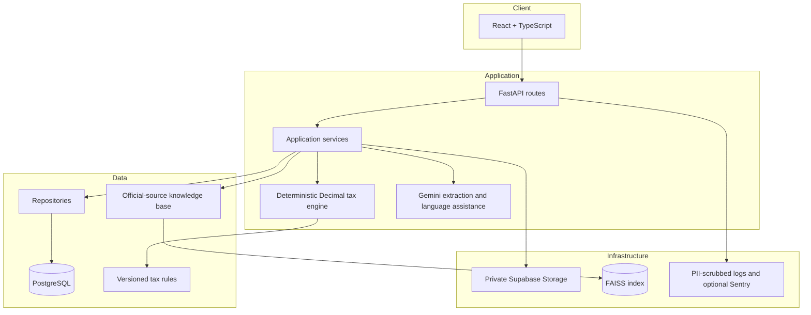

# FinTax AI

FinTax AI is an Indian tax-planning platform built around the workflow
**Upload → Extract → Verify → Calculate → Suggest → Explain & Act**.

The repository contains a React/Vite frontend and a FastAPI backend. Current
foundations include private document upload and extraction, profile
confirmation, a deterministic tax engine, auditable traces, regime comparison,
scenario suggestions, a what-if simulator, cited chat, reports, filing
guidance, and privacy controls. Some integrations and tax features remain
deliberately gated; see [Current limitations](#current-limitations).

## Product preview


## Architecture



The more detailed trust boundaries and request flow are in
[docs/architecture.md](docs/architecture.md).

## Project layout

- `backend/`: Python 3.12, FastAPI, SQLAlchemy, Alembic, tests, and versioned
  tax rules.
- `frontend/`: React, TypeScript, Vite, Tailwind, and responsive application UI.
- `docs/`: architecture and architecture decision records.
- `.github/`: Copilot project guidance and coding prompts.

## Local development

### Backend

Requires Python 3.12 and PostgreSQL for normal development. Install with
[uv](https://docs.astral.sh/uv/):

```bash
cd backend
uv sync --extra dev
cp .env.example .env
uv run alembic upgrade head
uv run uvicorn app.main:app --reload
```

Configure the database, Supabase, and optional Gemini settings in `backend/.env`.
The API is available at `http://localhost:8000`; health check:
`http://localhost:8000/api/v1/health`.

Run backend checks:

```bash
cd backend
uv run ruff check .
uv run pytest --cov=app.services.tax_engine --cov-report=term-missing
```

### Frontend

Requires Node.js 20.19+ or 22.12+:

```bash
cd frontend
npm ci
cp .env.example .env
npm run dev
```

Set the API base URL and public Supabase project settings in `frontend/.env`.
Run frontend checks with `npm run lint`, `npm test`, `npm run build`, and
`npm run test:e2e`. The Playwright journey uses mocked API responses.

## Operations and demo

- [Security and privacy controls](docs/security.md)
- [Deployment and environment variables](docs/deployment.md)
- [Three-minute demo walkthrough](docs/DEMO_SCRIPT.md)
- [Architecture decisions](docs/adr/)
- [Postman collection](docs/postman/FinTax-AI.postman_collection.json)

CI runs backend Ruff/pytest/dependency audit and frontend ESLint/Vitest/build,
dependency audit, and the mocked Playwright journey on pull requests and pushes
to `main`. After CI passes on `main`, deployment jobs use the configured Vercel
and Render secrets; without those secrets they report a skip. Configure the
required secrets and variables as documented in
[docs/deployment.md](docs/deployment.md).

## Important tax-rule status

**Do not use this project to file a return or treat its outputs as tax advice.**
The checked-in rule file contains explicit TODO placeholders. The calculation,
comparison, simulator, and suggestions endpoints fail closed until the
applicable rules and suggestion terms are verified against official sources
and versioned for the relevant financial year. See
`backend/app/rules/README.md` for the verification process.

The RAG directory also requires verified official documents before factual
answers can be presented as grounded. Upload virus scanning is still a hook
placeholder, and the end-to-end browser test mocks the API rather than calling
live Supabase, Gemini, or Render services. The included offline fallback only
serves responses already fetched in the current open browser session; it is
not a first-visit offline application.

Tax calculations must remain deterministic and use `Decimal`; Gemini may only
help explain engine-provided results. Tax rules belong in versioned data, not
application code. Every calculated amount should have a trace and a
plain-language explanation. Never log taxpayer PII, documents, sensitive
financial values, or secrets.

FinTax AI is guidance, not professional tax advice. Consult a qualified
professional for advice specific to your circumstances.
