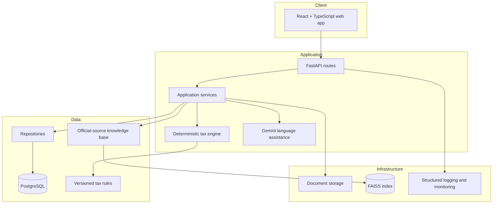

# Architecture

The system is organized into four layers. The API and frontend implement the
document, review, calculation, suggestions, chat, reports, filing-guidance, and
privacy workflows, with tax-rule and external-provider capabilities remaining
explicitly gated where their production inputs are not yet verified.

## Trust boundaries

- The frontend is an untrusted client; validate all input at API boundaries.
- The tax engine is deterministic and must not delegate arithmetic to an LLM.
- LLM outputs are untrusted language output; ground factual answers in cited,
  official-source knowledge-base material.
- Sensitive tax documents and personal data must never be written to logs.

## Request flow

The intended product flow is Upload → Extract → Verify → Calculate → Suggest →
Explain & Act. Services coordinate these steps; repositories own persistence;
versioned rule data supplies tax parameters. Each future calculation must retain
its inputs, intermediate steps, and plain-language “Why?” explanation.
